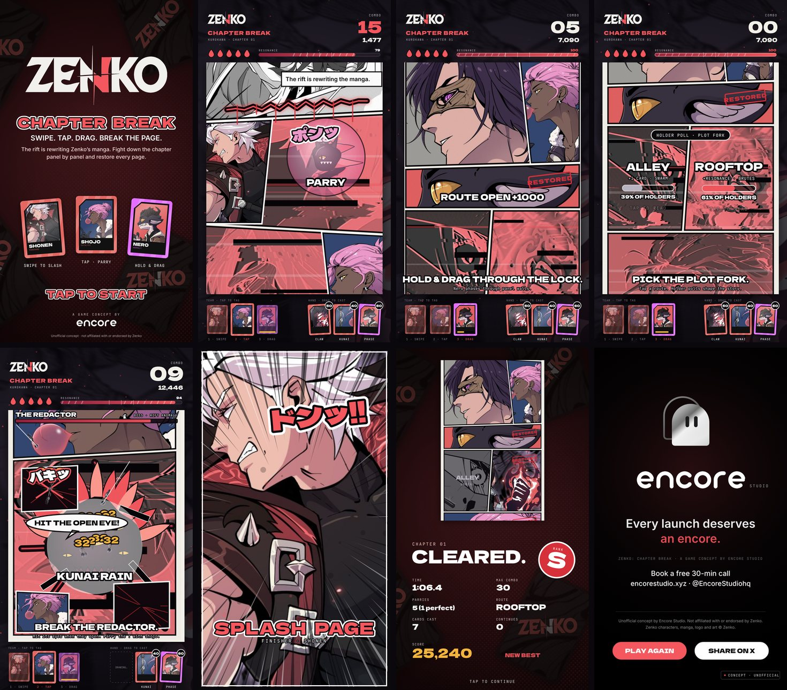

# Zenko · CHAPTER BREAK (playable)

A playable, unofficial Encore Studio game concept for [Zenko (@Zenko_NFT)](https://x.com/Zenko_NFT). It's the interactive version of the [CHAPTER BREAK concept video](../../videos/zenko-chapter-break/).

**The rift is rewriting Zenko's manga. Fight down the chapter panel by panel with Shonen, Shojo and Nero, and every panel you clear restores into Zenko's real art.**

## Play it

[Download `index.html`](https://github.com/AhmeddNaderr/Encore/raw/refs/heads/main/games/zenko-chapter-break/index.html) and open it in any modern browser, on a phone or a computer. It's one self-contained 2.2 MB file: art and fonts are embedded, it needs no internet connection, and it has no sound. A run takes about 1 to 3 minutes. Phones show it full screen in portrait; on a desktop it sits centred, playable with a mouse.

## How to play

Stop every enemy attack before its red ring closes, or you lose an ink drop (you have 5).

| Input | Hero | What it does |
|---|---|---|
| **Swipe** across enemies | Shonen (vanguard) | Claw slashes. Wiggle through a group to hit it repeatedly. |
| **Tap** an enemy | Shojo (catalyst) | Throws a kunai where you touch. |
| **Tap the red "!"** | Shojo | **Parry**: her bubble pops the attack and stuns the enemy. Tap late in the ring for a perfect parry. |
| **Hold & drag** | Nero (anomaly) | Nero follows your finger, damages everything he touches and phases through walls. He's the only one who can break "Locked by the rift". His gold bar drains while he's out. |
| **Tap a team card** (or keys 1, 2, 3) | | Swap heroes at any time, even mid-fight. |
| **Drag a card** from your hand onto the page | | Cast it. Cards cost Resonance, which you build by hitting, killing and parrying: Resonance Claw (50) hits everything, Kunai Rain (40) fires 14 kunai, Nero Phase (60) stuns everything and cancels attacks. |
| **Tap a route** | | **Plot fork** with sample holder-poll percentages. ALLEY gives an extra card and a wisp swarm; ROOFTOP gives Resonance and brutes. |
| **Pinch** (or drag the gold card) | | **Splash Page** finisher, once the boss drops below 30%. |

**The chapter:** a story panel, then a fight that teaches swiping, a fight that teaches the parry (time slows until you tag in Shojo), Nero's lock, the plot fork, a card fight on your chosen route, and the boss **The Redactor**. Hit its eyes when they open in their inset panels (big damage), parry its attacks and dodge its summoned wisps, then finish it with the splash page.

**Results:** time, max combo, parries, route, cards cast, continues, score and a rank (S needs no continues, 3+ ink drops left and 2+ parries). Then a sample WL leaderboard ("Bots can like a post. They can't clear a chapter."), and the Encore end card with **Play again** and **Share on X**. Share copies your result to the clipboard and opens an X post draft; nothing is posted automatically. Your best score is kept in your own browser only.

## Tested

An automated run plays the whole chapter with real pointer input (swipes, taps, parries, Nero drags, card drags, the route pick and the finisher), then checks game over and retry, a real two-finger touch pinch, a phone viewport (412×915) and a desktop viewport (1440×900). All passed with no script errors. I haven't tested it on physical devices.

## Credits and status

Zenko characters, manga, logo and art © Zenko ([@Zenko_NFT](https://x.com/Zenko_NFT)), from their public posts; faces aren't redrawn. Game design, code, enemy and boss sprites are original work by Encore Studio. Fonts: Dela Gothic One, Inter and JetBrains Mono (SIL Open Font License).

This is an unofficial concept with no affiliation or endorsement by Zenko. Leaderboard handles and poll percentages are samples, and nothing implies a live game, mint, whitelist or allocation. `source.zip` holds the game code and build scripts.
