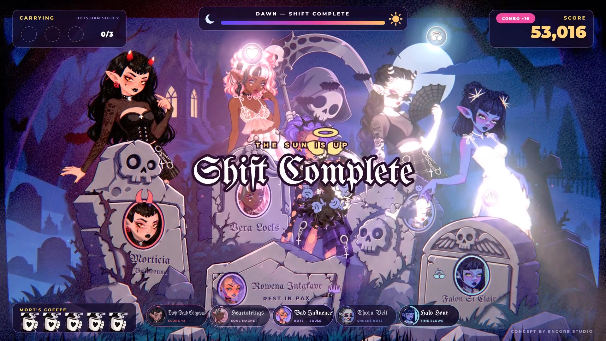

# Pax Gothamista · Reborn by Dawn

An unofficial Encore Studio game concept for Pax Gothamista: **a playable Three.js game built from their own art**, plus a trailer captured from it.

> *Buried in one world. Reborn in another.*

## The game
You fly **Mort the Intern** through their cemetery town.
- Catch falling souls; Mort carries three in a glowing chain.
- Fly over the grave with the matching emblem to raise that girl. The winged skull is Falon's, the thorn-wrapped stone Odette's, the flower arch Vera's, the skull crown Morticia's and the broken slab Rowena's.
- **Every girl you raise grants her power:**
  - Morticia, *Drop Dead Gorgeous*: score ×2
  - Vera, *Heartstrings*: soul magnet
  - Odette, *Thorn Veil*: a thorn ring that shreds bots
  - Falon, *Halo Hour*: slow-mo
  - Rowena, *Bad Influence*: bots turn into souls
- Grey **like-bots** hunt you and steal souls. Spin the scythe to banish them, because bots can like a post, but they can't raise the dead.
- Mort's five coffees are your lives; catch falling cups to refill.
- Raise all five at once for *The Gothly Departed*. The rare spiral soul raises their 1/1, Bella Saw.
- The shift ends at dawn, with an Orbituary card, a sample WL leaderboard and a copyable result.

## Downloads
- [Play it: one self-contained HTML file](https://github.com/AhmeddNaderr/Encore/raw/refs/heads/main/videos/paxgothamista/RebornByDawn-play.html). Download it and open it in a browser.
- [Game folder](game/): Three.js source, engine, assets and build ([how to run](game/GAME-README.md)).
- [Trailer: 45 s, 1920×1080, 60 fps](https://github.com/AhmeddNaderr/Encore/raw/refs/heads/main/videos/paxgothamista/PaxGothamista-Reborn-by-Dawn-3D-main.mp4)
- [Trailer: 720p](https://github.com/AhmeddNaderr/Encore/raw/refs/heads/main/videos/paxgothamista/PaxGothamista-Reborn-by-Dawn-3D-720p.mp4)
- [X cut: 15 s, 1080×1920, 60 fps](https://github.com/AhmeddNaderr/Encore/raw/refs/heads/main/videos/paxgothamista/PaxGothamista-Reborn-by-Dawn-3D-15s.mp4)
- The earlier 2D animatic is kept in `v1-2d/`.

## How it's built
- **Their art in 3D.** Their Deathly Offerings cemetery is a depth-warped background plate, and its five blank tombstones are cut out onto their own planes. The girls rise between them and Mort flies in front, all with parallax camera moves.
- **Live lighting on the 2D art.** Normal maps are generated from the official PNGs. Every soul carries a coloured light that sweeps across the stones, rising girls are underlit by their grave, and there is moonlight plus a warm dawn key.
- **Post and effects.** Bloom, moon god rays, chromatic aberration on hits, a night→dawn grade, film grain, GPU particles, fog, bats, clouds, lightning and power auras.
- **One engine everywhere.** The trailer is captured frame-exactly from the real game engine played by its autopilot; no shot is faked.
- **Original audio.** The score and every sound effect are original ([AUDIO-SOURCES.md](AUDIO-SOURCES.md)).

The leaderboard uses placeholder handles, the X post is a mock-up, and no WL is granted. **Handle note:** `@Pax_Gothamistan` does not exist on X. This concept is for **[@Pax_Gothamista](https://x.com/Pax_Gothamista)** (artist [@MynddNFT](https://x.com/MynddNFT)).

Unofficial concept by Encore Studio. Not affiliated with or endorsed by Pax Gothamista. Pax Gothamista characters and art © Pax Gothamista. No post, DM or contact with the project was made.
