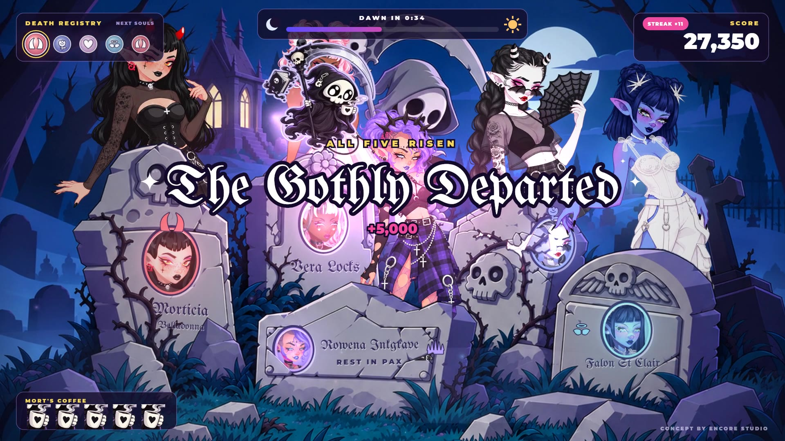

# Pax Gothamista · Reborn by Dawn — v1 (2D animatic)

An unofficial Encore Studio game concept trailer for Pax Gothamista, made from their own art. Pax Gothamista is the cemetery town where the dead have a little more living to do.

**The game:** souls are falling into Mort the Intern's hands. File each one into the grave that matches her personality and she rises reborn: the winged skull for Falon, the thorn-wrapped stone for Odette, the flower arch for Vera, the skull crown for Morticia and the broken slab for Rowena. A wrong grave spills one of Mort's five coffees. Raise all five at once for *The Gothly Departed*, keep a 15-streak to raise a 1/1, and get everyone up before the sun.

> *Buried in one world. Reborn in another.*

## Downloads

- [Main video: 45 s, 1920×1080, 60 fps](https://github.com/AhmeddNaderr/Encore/raw/refs/heads/main/videos/paxgothamista/v1-2d/PaxGothamista-Reborn-by-Dawn-main.mp4)
- [Smaller main video: 720p](https://github.com/AhmeddNaderr/Encore/raw/refs/heads/main/videos/paxgothamista/v1-2d/PaxGothamista-Reborn-by-Dawn-720p.mp4)
- [X cut: 15 s, 1080×1920, 60 fps](https://github.com/AhmeddNaderr/Encore/raw/refs/heads/main/videos/paxgothamista/v1-2d/PaxGothamista-Reborn-by-Dawn-15s.mp4)
- [Source package: game engine, renderer, score, research, art bible](https://github.com/AhmeddNaderr/Encore/raw/refs/heads/main/videos/paxgothamista/v1-2d/PaxGothamista-Reborn-by-Dawn-sources.zip)

All MP4s use H.264 video, stereo AAC audio (−16 LUFS) and faststart.

## How it was made

- **Real game logic.** Every gameplay shot comes from a deterministic engine (`engine.js`). It handles soul queues, Mort's flight, grave matching, streak multipliers, coffee lives, the all-five bonus, the 1/1 and the dawn timer. Autoplay takes are rendered at 60 fps; the trailer is not a slideshow.
- **Their art, untouched.** The board is their Deathly Offerings cemetery, and its five blank tombstones are cut out so the girls can rise from behind them. The cast, Mort, cameo portraits, the wordmark, the Mortuary and Orbituary art and Bella Saw are all official files from paxgothamista.xyz and @Pax_Gothamista. The only new pixels are effects, UI and type.
- **Their lore.** It draws on the Death Registry (WL), Mass Death Registry (collabs), the Orbituary status check (Alive / Dead), Mort's fifth coffee, "every grave has a personality", the horror-villain 1/1s, and #RestInPax.
- **Original audio.** The score and every sound effect are original; see [AUDIO-SOURCES.md](../AUDIO-SOURCES.md).

The leaderboard is a sample with placeholder handles, the X post is a mock-up, and no WL is granted. **Handle note:** `@Pax_Gothamistan` does not exist on X. This concept is for **[@Pax_Gothamista](https://x.com/Pax_Gothamista)** (artist [@MynddNFT](https://x.com/MynddNFT)).

Unofficial concept by Encore Studio. Not affiliated with or endorsed by Pax Gothamista. Pax Gothamista characters and art © Pax Gothamista. No post, DM or contact with the project was made.
