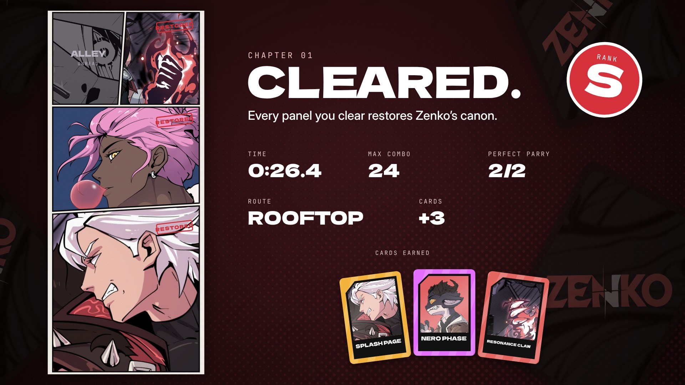

# Zenko · CHAPTER BREAK

An unofficial Encore Studio game concept video for [Zenko (@Zenko_NFT)](https://x.com/Zenko_NFT): "Where digital manga meets collectible cards." It's the second, more interactive concept, following [PANEL CUT](../zenko/).

**The rift is rewriting Zenko's manga. Fight through the chapter panel by panel with a three-hero team, and every panel you clear restores into Zenko's real art.**

## Downloads

- [Main video: 47 seconds, 1920×1080, 60 fps, silent, 48.9 MB](https://github.com/AhmeddNaderr/Encore/raw/refs/heads/main/videos/zenko-chapter-break/Zenko-Chapter-Break-main.mp4)
- [Vertical video for X: 15 seconds, 1080×1920, 60 fps, silent, 19.4 MB](https://github.com/AhmeddNaderr/Encore/raw/refs/heads/main/videos/zenko-chapter-break/Zenko-Chapter-Break-15s.mp4)
- [Source package: game script, renderer and docs](https://github.com/AhmeddNaderr/Encore/raw/refs/heads/main/videos/zenko-chapter-break/Zenko-Chapter-Break-sources.zip)

Both MP4s are H.264 High (yuv420p, BT.709) with faststart and **no audio track**. Exact frame counts (2820 and 900), a full decode and freeze detection were checked. Every rule reads through on-screen captions, prompts and manga sound-effect lettering. Hashes are in [SHA256SUMS](SHA256SUMS); self-review scores and their limits are in [the quality report](quality_report.md).

## The game

You scroll down a vertical-scroll manga chapter (Zenko's planned format). The anomalies have corrupted every panel: inverted, red-shifted and redacted. Each hero plays with a different touch gesture, and a visible finger shows every input in the video.

| Input | What it does |
|---|---|
| **Swipe** · Shonen (vanguard) | Claw slashes. Multi-hit combos on whatever you swipe through. |
| **Tap** · Shojo (catalyst) | Kunai land wherever you touch. Tap a telegraphed attack (the red "!") at the right moment to **parry** it with her bubble-gum bubble and stun the enemy. |
| **Hold & drag** · Nero (anomaly) | Drag Nero along a path; he phases straight through panel walls. He shatters the "LOCKED BY THE RIFT" panel to open the route, and pierces the boss. |
| **Tap a team card** | Tag-swap heroes mid-fight, even mid-combo. |
| **Drag a TCG card** | Cards in your hand are your moveset: drag "Resonance Claw" onto the panel to cast a page-wide slash. Clearing earns new cards (the gold "Splash Page" finisher). |
| **Tap a route** | **Plot fork:** the chapter branches (ALLEY or ROOFTOP), with holder-poll percentages on each path. The unchosen route stays "unread" and is replayable. |
| **Pinch** | Finisher: the boss panel explodes into a full-screen **Splash Page**. |

**Boss: The Redactor.** A rift anomaly spanning a whole panel, with weak-point eyes in inset panels. Shojo parries its attack and kunai the eyes, Nero drags through it, and Shonen's pinch finishes it with the splash page.

**Result:** time, max combo, perfect parries, route, cards earned and a rank, beside the fully restored chapter, ready to share. Bots line: "Bots can like a post. They can't clear a chapter."

**Why it's Zenko's:** it uses the vertical-scroll digital manga, the TCG card hand and the holder-poll plot forks from Zenko's own roadmap, plus the Kurokawa rift lore and the three archetypes' roles (vanguard, catalyst, anomaly).

## Art

Every character, panel and logo comes from Zenko's own posts at full resolution: the banner Shonen, the Shojo, Nero, the katana and scythe portraits, their greyscale manga page, their TCG card frame and their card backs. Faces are never redrawn. The "corrupted" panels are the same art filtered (inverted, red-shifted, sliced), and they ink back to the original. The anomalies and the boss are original sprites in Zenko's red-black Resonance palette. The video ends on Encore's current brand: the chrome mascot, the "encore" wordmark and **"Every launch deserves an encore."**

## Credits and status

Zenko characters, manga, logo and art © Zenko ([@Zenko_NFT](https://x.com/Zenko_NFT)). The game concept, animation, enemy and boss sprites are original work by Encore Studio.

This is an unofficial concept with no affiliation or endorsement by Zenko. Leaderboard handles, poll percentages and X engagement numbers are samples, the post is a mock-up, and nothing implies a live game, mint date or whitelist allocation. No social post, DM or project contact was made.
