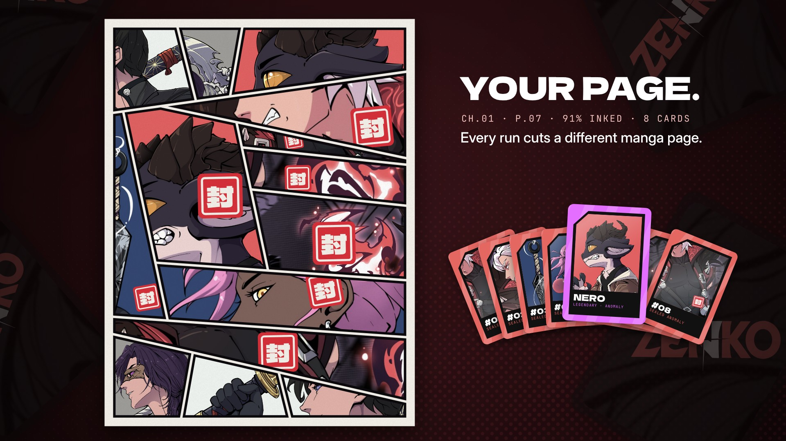

# Zenko · PANEL CUT

An unofficial Encore Studio game concept video for [Zenko (@Zenko_NFT)](https://x.com/Zenko_NFT), whose X bio reads "Where digital manga meets collectible cards." In the game you **cut manga panels across a page to trap the anomalies leaking from the Kurokawa rift.** Every anomaly you trap seals into a trading card, and every run leaves you with your own finished manga page.

## Downloads

- [Main video: 44 seconds, 1920×1080, 60 fps, silent, 41.2 MB](https://github.com/AhmeddNaderr/Encore/raw/refs/heads/main/videos/zenko/Zenko-Panel-Cut-main.mp4)
- [Vertical video for X: 15 seconds, 1080×1920, 60 fps, silent, 16.8 MB](https://github.com/AhmeddNaderr/Encore/raw/refs/heads/main/videos/zenko/Zenko-Panel-Cut-15s.mp4)
- [Source package: renderer, game simulation, planner, score, research and storyboard](https://github.com/AhmeddNaderr/Encore/raw/refs/heads/main/videos/zenko/Zenko-Panel-Cut-sources.zip)

Both MP4s are H.264 High (yuv420p, BT.709) with faststart and are **silent, with no audio track**. Exact frame counts (2640 and 900), a full decode and freeze detection were checked, and hashes are in [SHA256SUMS](SHA256SUMS). Self-review scores and their limits are in [the quality report](quality_report.md).

## The game

| | |
|---|---|
| **Rule** | Cut the page. Trap the anomaly. |
| **Loop** | The rift cracks open on a blank manga page and anomalies spill out. You swipe to cut a gutter, and the line grows from your finger to both panel edges. If an anomaly touches it before it finishes, the line breaks (バキッ) and you lose a life. An empty panel inks into story art. A small panel holding exactly one anomaly seals: the 封 ("seal") hanko stamps down and the anomaly flips out as a card. |
| **Shonen (vanguard)** | Resonance Burst: a full meter unleashes a flurry of claw cuts across the whole page. |
| **Shojo (catalyst)** | Kunai Pin: kunai pin anomalies inside bubble-gum bubbles so you can cut safely and chain combos. |
| **Nero (anomaly)** | The rare golden-eyed pull. Sealing Nero gives the legendary purple card ("NEROOOOO."). |
| **Share moment** | The page you cut is your own manga page, filled with Zenko art, plus the hand of cards you sealed. |
| **Bots line** | "Bots can like a post. They can't draw the line." |

Why it's Zenko's: it uses all three pillars of the project at once. The page is the manga, the sealed anomalies are the TCG, and the cutting re-draws the fractured boundary between the city and the spirit realm, as told in Zenko's pinned lore article.

## How it was made

- **Their art only.** Every character, panel, logo and card back comes from Zenko's own posts at full resolution: the banner Shonen, the Shojo kunoichi, Nero, the katana and scythe portraits, their official greyscale manga page, their TCG card frame (coral with a notched corner, purple for the legendary) and their ink-swirl card backs. Faces are never redrawn; portraits only get background removal and are cropped into panels. The anomalies are original game sprites in Zenko's red-black Resonance palette. Source URLs and hashes are in `art_sources.csv` inside the source package.
- **Real gameplay simulation, not a slideshow.** A deterministic physics simulation (convex panel splitting with gutters, bouncing anomalies, growing cut lines, break and seal rules) plays a planned "skilled run". A planner searches cut timings and angles for each beat (near-miss seals, a deliberate break, the Shojo double seal, the Nero pull, the burst). Every frame is rendered from that simulation at 60 fps.
- **Silent by design.** The videos have no sound and every beat reads through on-screen captions and manga sound-effect lettering. An earlier version had an original synthesized score; its generator, `compose.py`, is still in the source package.
- **Current Encore brand.** The end card uses Encore's current identity: the chrome mascot (redrawn as a vector from the official avatar), the "encore" wordmark from the official banner, and the slogan **"Every launch deserves an encore."**

## Credits and status

Zenko characters, manga, logo and art © Zenko ([@Zenko_NFT](https://x.com/Zenko_NFT)). The game concept, animation, anomaly sprites, music and effects are original work by Encore Studio.

This is an unofficial concept with no affiliation or endorsement by Zenko. The leaderboard handles and X engagement numbers are samples, the post is a mock-up, and nothing implies a live game, mint date or whitelist allocation. Zenko has said its own manga and TCG come after mint, so nothing here should be read as their roadmap. No social post, DM or project contact was made.
